# Keylight

[](https://ko-fi.com/scizers)

**Mac** · **Windows (beta)** · iOS & Android coming soon · [Download](https://github.com/scizerss/keylight-piano/releases/latest)

An open-source piano-learning app for the light-up keyboards ROLI made (the 24-key Piano M
and LUMI Keys, and in beta [the 49-key ROLI Piano](#the-49-key-roli-piano-beta)), for people
whose keyboard lost its app when ROLI Learn was discontinued.
Falling notes in 3D over a keyboard that looks like yours, the real keys lighting up
the next note, lessons, songs, games and a Playground, all running on your Mac or
Windows PC with no account. On a Mac the lighting goes through the open-source
[blocksd](https://github.com/hyperb1iss/blocksd) daemon; on Windows the keys light up
over plain MIDI (see [Install on Windows](#install-on-windows)).

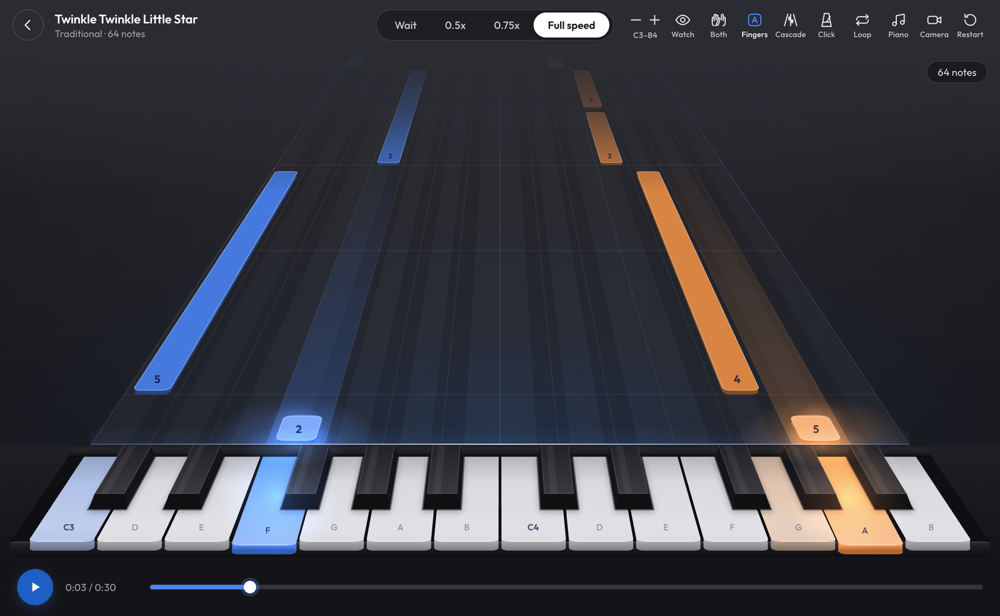

## See it in action

| Drop in an MP3: notes, cover and synced lyrics | Four note views |
|---|---|
| [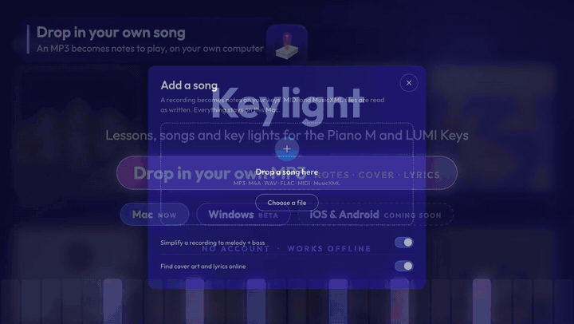](https://github.com/scizerss/keylight-piano/releases/download/v0.2.1/keylight-tour.mp4) | [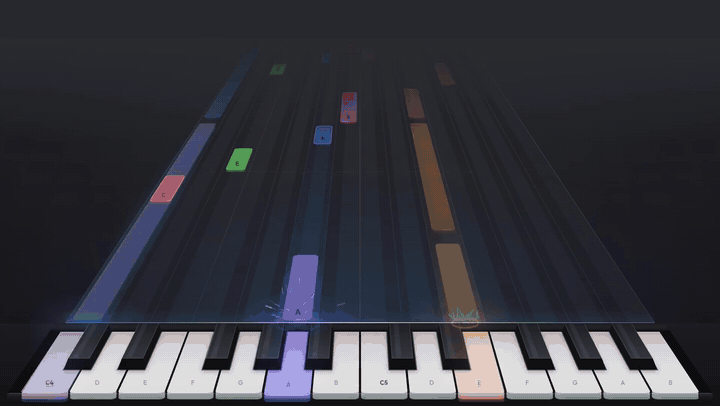](https://github.com/scizerss/keylight-piano/releases/download/v0.2.1/keylight-tour.mp4) |

Full videos with sound: [app tour (65 s)](https://github.com/scizerss/keylight-piano/releases/download/v0.2.1/keylight-tour.mp4) ·
[teaser with the real keyboard (31 s)](https://github.com/scizerss/keylight-piano/releases/download/v0.2.1/keylight-teaser.mp4)

> Keylight is an independent, unofficial project. It is not affiliated with, endorsed
> by or supported by ROLI. ROLI, LUMI, Piano M and ROLI Learn are trademarks of their
> respective owners, used here only to say which keyboards Keylight works with.
> Keylight contains no ROLI software, firmware, artwork, sounds or lesson content.

## What it does

- **Drop in any MP3 and learn it.** Keylight turns the song into notes you can
  practise, picks up its cover art and lyrics, and scrolls time-synced lyrics while
  you play. The notes are worked out on your own computer and the file is never
  uploaded; cover and lyrics come from the file's tags, or from a quick online lookup
  (iTunes Search, LRCLIB) that you can switch off. MIDI and MusicXML work too.
- Four note views: a 3D cascade, Rainbow, Colornote and Classic, and sheet music above
  them that follows along for any MusicXML song
- The keyboard's own keys light up the next note; on a Mac, in four light styles you
  switch with the keyboard's mode button
- Wait mode (the song waits for you on every note), 0.5x / 0.75x / full speed, loop
  a section, left, right or both hands, count-in, metronome, note names or finger
  numbers
- 19 songs, 5 lessons (Watch, Practise, Play), exercises in every key (major, natural and
  harmonic minor scales, five-finger patterns, arpeggios, I–IV–V–I chords), a Playground with
  19 scales and live chord names, 4 arcade games, 3 note-reading games, stars, streaks and
  achievements
- Play with feeling: 8 instruments and the sustain pedal; on sustained sounds such as
  strings, press into a key to swell it and wiggle it for vibrato
- A hand-tracking beta: a camera over the keys shows which finger is over which key

| Add a song | Lyrics while you play |
|---|---|
| 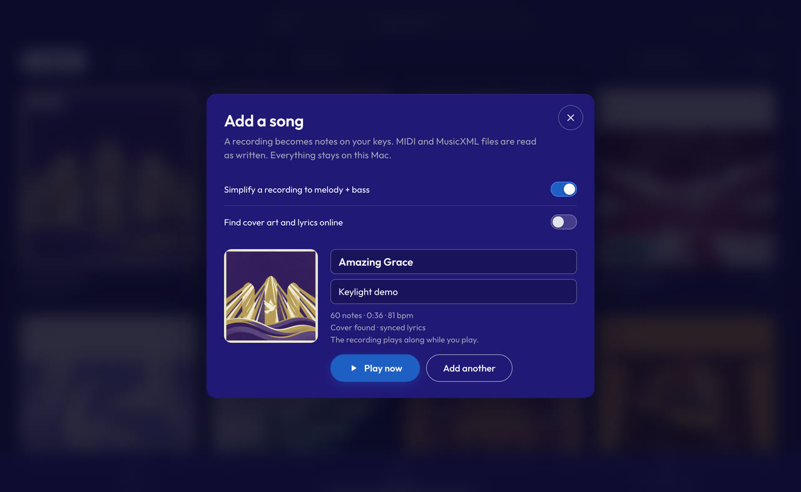 | 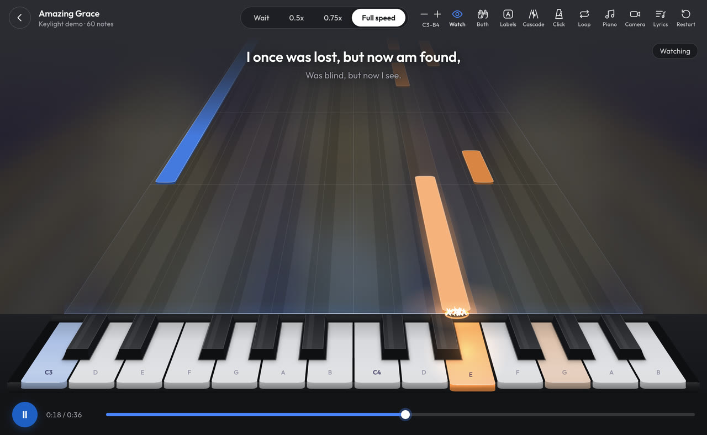 |

| Home | Lessons |
|---|---|
| 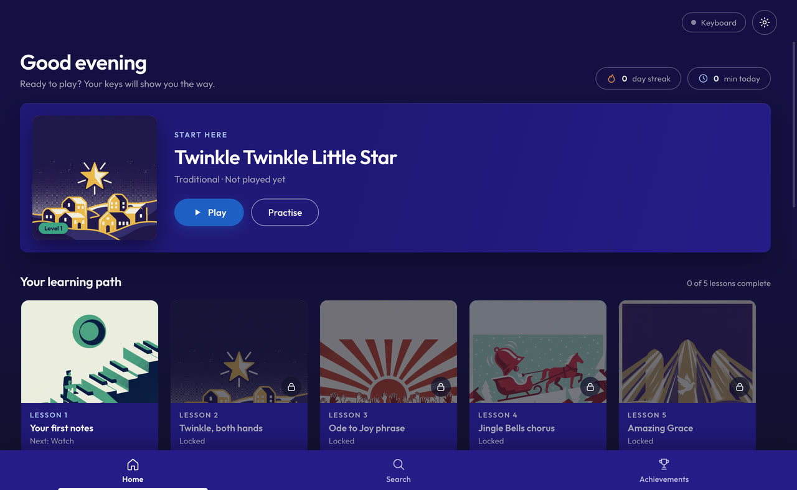 | 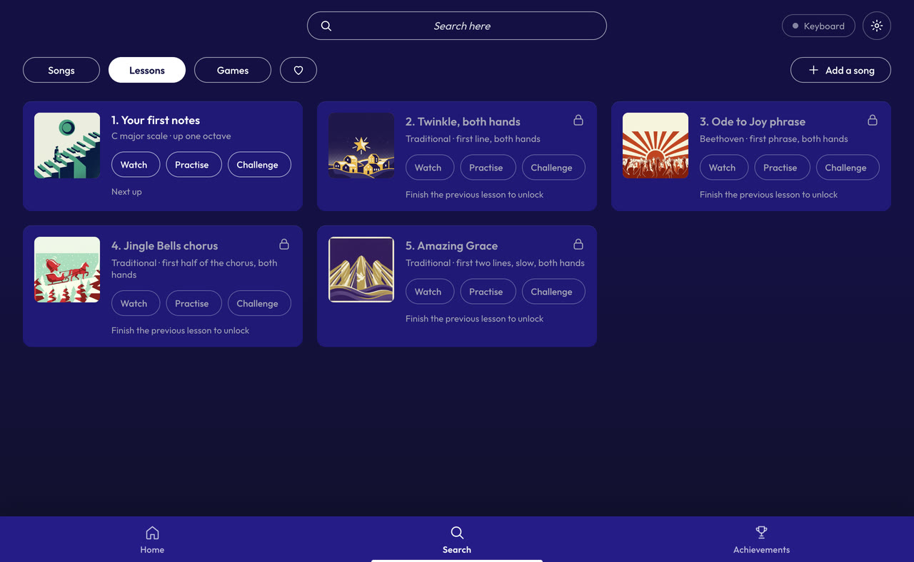 |

| Song library | Playground |
|---|---|
| 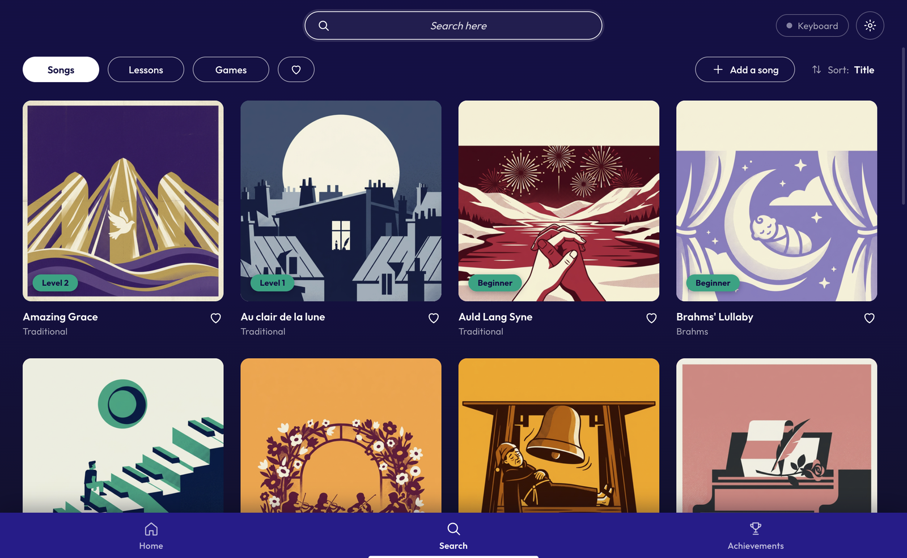 | 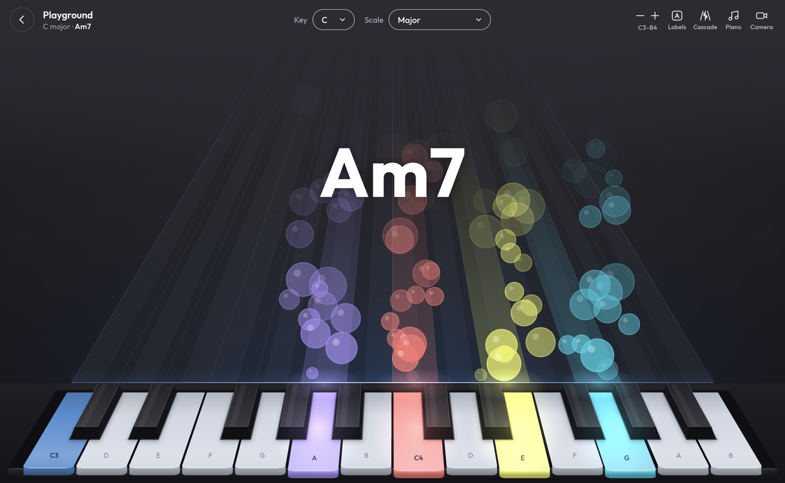 |

| Rainbow view | Classic view |
|---|---|
| 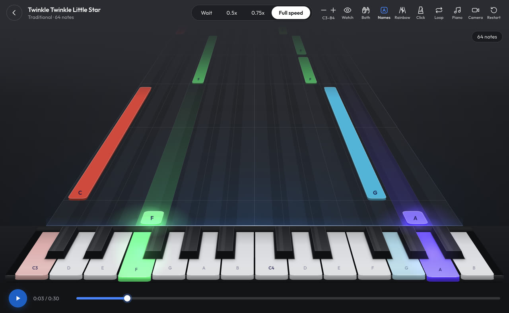 | 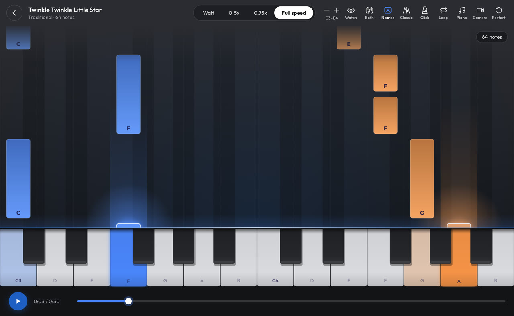 |

| Scales & Chords | Settings |
|---|---|
| 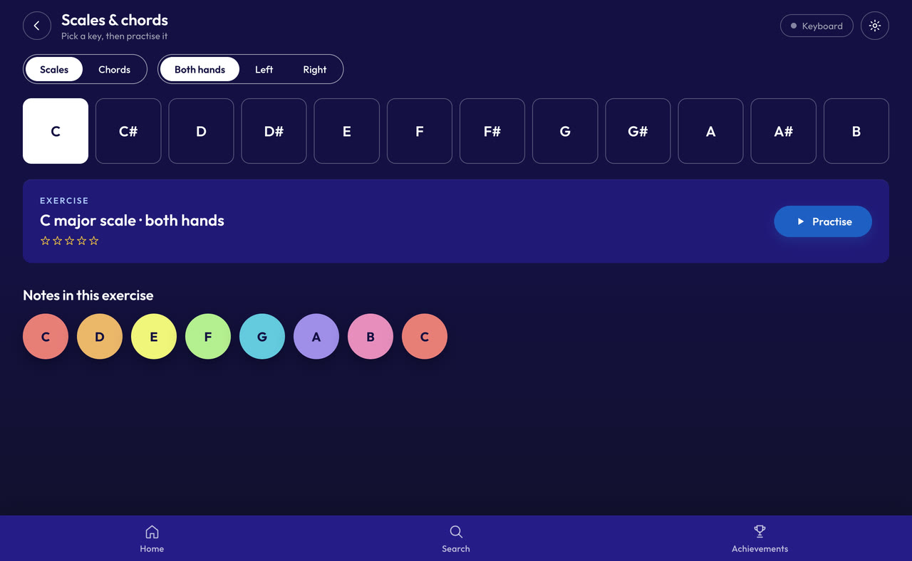 | 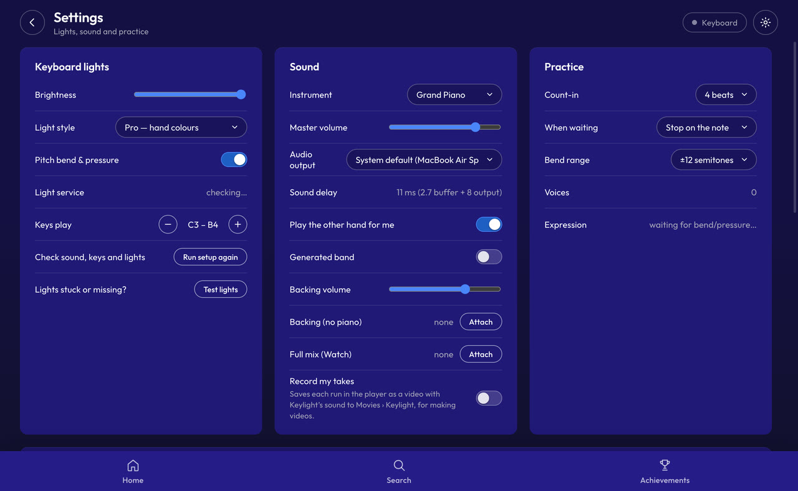 |

## Requirements

- A Mac with Apple Silicon (M1 or later) on macOS 13 or newer, or a 64-bit PC with
  Windows 10 or 11
- A ROLI Piano M or LUMI Keys over USB, or in beta the [49-key ROLI Piano](#the-49-key-roli-piano-beta)
- On a Mac, [blocksd](https://github.com/hyperb1iss/blocksd) for the key lights (step 4
  below). Windows needs nothing else: the keys light from plain MIDI notes
  there (see [Install on Windows](#install-on-windows))
- To build from source: git and Node.js 22.12 or newer. Optional for the video tools
  in `scripts/`: ffmpeg, and Python 3 with numpy (and scipy for `measure-take-sync.py`)

## Install

On a Mac (for Windows, see [Install on Windows](#install-on-windows)). You need a Mac
with Apple Silicon (M1 or later) on macOS 13 or newer, and the keyboard.

1. Download `Keylight-<version>-mac.zip` from the
   [Releases page](https://github.com/scizerss/keylight-piano/releases) and double-click it. You get a
   `Keylight-<version>` folder with `Keylight.app` and a copy of these steps.
2. Keylight is not notarised by Apple, so macOS refuses to open it until the download
   quarantine is cleared. In Terminal:

   ```sh
   xattr -dr com.apple.quarantine ~/Downloads/Keylight-<version>/Keylight.app
   ```

   (Unzipped somewhere else? Type `xattr -dr com.apple.quarantine `, drag `Keylight.app`
   onto the Terminal window and press Return.)
3. Move `Keylight.app` to Applications.
4. Install blocksd, the daemon that drives the key lights. With [Homebrew](https://brew.sh):

   ```sh
   brew install uv python@3.13
   uv tool install --python /opt/homebrew/bin/python3.13 --from "git+https://github.com/hyperb1iss/blocksd@main" blocksd
   ```

   You never run it yourself: Keylight starts it, and restarts it if the keyboard
   drops off it.
5. Plug the keyboard in over USB, switch it on, and open Keylight.

- The camera permission is only asked when you start hand tracking (Settings → Hand
  tracking).
- The keyboard's arrow and mode buttons need a one-line change to blocksd that is not
  upstream yet (see [Hardware buttons](#hardware-buttons) below); the octave buttons and
  everything else work without it.
- Progress and the log live in `~/Library/Application Support/lumi-app/`, so updating
  the app keeps your stars. If something goes wrong, attach `app.log` from there to
  your report.

## Install on Windows

You need a 64-bit PC with Windows 10 or 11, and the keyboard. Windows support is new
and has not been tried with a Piano M or LUMI Keys on Windows yet: please say how it goes
in an [issue](https://github.com/scizerss/keylight-piano/issues).

1. Download `Keylight-<version>-win-x64.zip` from the
   [Releases page](https://github.com/scizerss/keylight-piano/releases).
2. Right-click the zip, choose **Extract All...**, then **Extract**. Windows makes a
   `Keylight-<version>-win-x64` folder next to the zip, with a `Keylight` folder and a
   copy of these steps in it. You can move that folder anywhere, for example into
   Documents.
3. Open the `Keylight` folder and double-click `Keylight.exe`. Keylight is not
   code-signed, so the first time Windows may say "Windows protected your PC": click
   **More info**, then **Run anyway**. (Right-click the zip, **Properties**, tick
   **Unblock** and click **OK** before extracting it, and the warning does not appear.)
   To find Keylight in the Start menu later, right-click `Keylight.exe` and choose
   **Pin to Start**.
4. Plug the keyboard in over USB, switch it on, and open Keylight. Close other apps that
   use the keyboard first (ROLI Connect, a DAW): on most PCs only one app at a time can
   use a MIDI keyboard.

What is different on Windows:

- blocksd, which drives the per-key colours on a Mac, runs on macOS and Linux only. On
  Windows Keylight lights the keys with plain MIDI notes: the note to play now, the next
  notes and the notes practice waits for. Its own colours go out while Keylight runs, so
  only those keys are lit, and come back as rainbow when it closes. Each note's velocity
  picks its colour, so the light styles and your own colour work, within what the
  keyboard's palette can show. Test lights and the setup run a light across the keys too.
- Not on Windows for now: the brightness
  slider, the light show after a song, finding the keys with the camera, moving the
  keys' octave from the app (use the octave buttons on the keyboard: Keylight follows
  them), the battery level, and the keyboard's arrow and mode buttons.
- Progress and the log live in `%APPDATA%\lumi-app\`; takes are saved to
  **Videos > Keylight**.
- Windows 11 with Smart App Control switched on may block unsigned apps like Keylight
  without offering **Run anyway**.

## Build from source

Needs git and Node.js 22.12 or newer, on an Apple Silicon Mac (the commands below) or
on Windows (see below).

```sh
git clone https://github.com/scizerss/keylight-piano.git keylight
cd keylight
npm ci
env -u ELECTRON_RUN_AS_NODE npm start    # run from source
npm test                                 # unit tests (watchdog, takes, Windows build)
scripts/package.sh                       # build Keylight.app
```

`env -u ELECTRON_RUN_AS_NODE` is needed when launching from another Electron app,
otherwise Electron runs as plain Node.

`scripts/package.sh` builds `Keylight.app` from the Electron in `node_modules`
(app code: `main.js`, `package.json` and `renderer/`), signs it ad hoc, installs it as
`~/Applications/Keylight.app` and zips it with the install steps above as
`dist/Keylight-<version>-mac.zip`. The previous bundle is renamed to
`Keylight.app.old`, not deleted, so a copy that is still running carries on (delete it
once Keylight has quit). It also
keeps a Keylight shortcut and `Start Keylight.command` (runs it from a Terminal
window) on the Desktop; `scripts/package.sh --zip-only` builds the zip without
installing. The icon comes from `assets/icon.png` via `scripts/make-icon.sh`; without
one a generated stand-in is used. Release checklist: `docs/RELEASING.md`.

On Windows, in PowerShell or Command Prompt:

```sh
git clone https://github.com/scizerss/keylight-piano.git keylight
cd keylight
npm ci
npm start                                # run from source
npm test
npm run package:win                      # build the Windows zip
```

`npm run package:win` (`scripts/package-win.js`) builds
`dist/Keylight-<version>-win-x64.zip` and runs on Windows, macOS or Linux alike. It
downloads Electron for Windows x64 once (cached), checks it against the checksum that
npm's `electron` package ships, renames `electron.exe` to `Keylight.exe` with the icon
from `assets/icon.ico` and Keylight's version details, turns off the same Electron fuses
as the Mac build, and adds the app, the licences and a `README.txt` with the
[Install on Windows](#install-on-windows) steps. `--keep` also leaves the unzipped
files in `dist/Keylight-<version>-win-x64/`, laid out as Extract All lays them out.
`assets/icon.ico` is made from `assets/icon.png` on a Mac by `node scripts/make-ico.js`.
The repository's `.gitattributes` gives every checkout LF line ends, so the zip built
on Windows holds the same files as the one built on a Mac.

### Test and screenshot flags

Always give test runs their own profile with `LUMI_USERDATA`, so they don't write
stars and lessons into your real progress or take the real app's port:

```sh
LUMI_USERDATA=/tmp/keylight-test LUMI_SELFTEST=1 env -u ELECTRON_RUN_AS_NODE npm start
```

- `LUMI_SELFTEST=1` runs the engine checks and prints `SELFTEST …` lines to stdout and
  to the profile's `app.log` (`$LUMI_USERDATA/app.log` for a test profile,
  `~/Library/Application Support/lumi-app/app.log` for the real one). The window stays
  hidden and the app keeps running: press Ctrl-C after `SELFTEST done` (about a
  minute). Two checks go online (cover and lyrics lookup, the hand-tracking model).
- `LUMI_SELFTEST_QUIT=1` makes the self-test quit when it is done: exit code 0 after
  `SELFTEST done`, 1 when it failed or printed a `FAIL` line, 2 when it has not finished
  after `LUMI_SELFTEST_TIMEOUT` seconds (300). `npm run selftest` runs it this way in a
  throwaway profile, on macOS or Windows, and prints the `SELFTEST` lines; CI runs it
  on both.
- `LUMI_NO_KEYBOARD=1` keeps a test run off MIDI and the key lights, so it neither
  hears the keyboard nor takes its lights from a Keylight you are playing in. It does
  not check on, start or restart blocksd either.
- `LUMI_QUERY=platform=win` (or `platform=mac`) shows the other system's wording and
  light handling, for checking the Windows page on a Mac.
- `LUMI_QUERY=perf=1` prints `PERF …` lines: each instrument's onset and ring-down, and
  how long a key press can wait on the main thread while a song plays.
- `LUMI_SHOT=/tmp/x.png` captures the window `LUMI_SHOT_DELAY` ms (default 3000) after
  the page loads, and quits.
- `LUMI_FRAMES=/tmp/frames` saves `frame-00001.png`, `frame-00002.png`, … instead, at
  `LUMI_FRAMES_FPS` (15) for `LUMI_FRAMES_SECONDS` (12), starting `LUMI_SHOT_DELAY` ms
  after load, then quits. A capture that runs late repeats the previous frame, so the
  frames always play back in real time.
- `LUMI_QUERY="demo=twinkle&pos=3&view=RAINBOW&labels=names"` deep-links into the
  player; `screen=home|search|achievements|toolbox|games|settings`, `chip=lessons`,
  `freeplay=0` also work.
- `LUMI_WATCHDOG=1` (or `0`) turns the periodic blocksd check on (or off). Test profiles
  only run the check at start-up, so they never restart the daemon the real app uses.

### Demo videos

```sh
scripts/record.sh 'demo=twinkle&pos=2' ~/Desktop/twinkle.mp4 8   # a song demo starts playing by itself; add autoplay=<ms> to control when
```

runs the app from the checkout with a throwaway profile, records `LUMI_QUERY` for the
given seconds (default 12) and writes an H.264 mp4 (15 fps) and a gif next to it
(720 px wide, 12 fps). Needs ffmpeg (`brew install ffmpeg`). For a 60 fps clip with the
app's sound, use `scripts/record-clip.sh` (see Recording takes).

## Screens

- **Home**: continue card, your learning path (lessons with Watch → Practise →
  Challenge steps), songs, explore (scales & chords, games, playground), recently played.
- **Search**: the "Search here" field, Songs / Lessons / Games / Favourites chips (and
  Imported once you have added a song), Sort by title, level or recently played,
  illustrated covers with level badges, and **Add a song** (also: drop a file anywhere
  on the window).
- **Achievements**: streak, minutes, stars, songs played, this week's practice, badges,
  best scores.
- **Player**: full screen. Speed track (Wait · 0.5x · 0.75x · Full speed, where Wait is
  practice mode), Watch, hands, labels, view, metronome, loop, instrument, restart;
  falling notes in four views; play button and seekable progress bar with loop markers.
- **Results**: stars, accuracy ring, perfect/good/early/late/missed, per-hand accuracy,
  next steps.
- **Settings** (gear icon): lights, sound, practice, progress.

## Adding your own songs

Search → **Add a song**, or drop a file on the window:

- **Recordings** (MP3, M4A, WAV, FLAC, AAC, OGG, AIFF) are turned into notes on your computer
  by Spotify's open-source Basic Pitch model. *Simplify to melody + bass* keeps the top
  note and a bass line, which is far easier on 24 keys than every voice of a full mix.
  Works best on piano or solo-instrument recordings. The original recording plays along
  in sync while you play, and keeps its pitch at 0.5x / 0.75x. Recordings up to 20
  minutes can be added.
- **MIDI** and **MusicXML** files are read as written.
- Title, artist and cover come from the file's tags (or a "Artist - Title" file name).
  With *Find cover art and lyrics online* on, missing covers come from the iTunes Search
  API and time-synced lyrics from LRCLIB; they scroll at the top of the player.
- Drop a `.lrc` lyrics file while a song is open to add or replace its lyrics.
- Imported songs are kept in the app's own library (IndexedDB) with their audio, cover
  and lyrics, marked YOURS; hover a tile to remove one.

YouTube and Spotify links are not supported: Spotify streams are DRM-protected and
downloading YouTube audio breaks its terms. Import a file you have instead.

`scripts/build-vendor.sh` rebuilds `renderer/vendor/` (Basic Pitch + TensorFlow.js,
music-metadata) and `renderer/models/basic-pitch/` from npm.

## Playground

Free play with the keyboard's own 19 scales (Major, Minor, Pentatonic, Blues, modes,
Japanese, Whole tone, Chromatic, …) on any key: the scale's keys glow faintly in the
light style's colour, the root brighter, and every key you press sends up a bubble.

## Hand tracking (beta)

Settings → Hand tracking: point a camera down at the keys (on a Mac, an iPhone in Desk
View works best), press **Find the keys** (Mac only: it lights the keys one by one), and numbered finger badges appear over the keys your
fingers are above. Details, hardware options and the roadmap: `docs/HAND-TRACKING.md`.

## Timing

Everything the app plays (the song in Watch, the other hand and out-of-range notes in
Play/Practise, generated band, metronome, count-in) is scheduled on the audio clock
about 200 ms ahead by `renderer/scheduler.js`, so notes start exactly on time no
matter how the screen refreshes, and repeated notes are struck again. The visible
position subtracts the audio output latency, so falling notes, key lights, wait
gating and scoring line up with what you hear.

## Keyboard octave

The app sets the keyboard's octave so its 24 keys play exactly the notes the song's
window lights. It learns the keys' range from what they actually send: a note outside
the expected range, or pressing the same note an octave off twice while practice
waits, recalibrates it. Move the octave with the − / + buttons on the keyboard, the
Octave − / + at the top right of the player, Z / X, or Settings → Keys play.

The keyboard's arrow buttons depend on where you are: in a song, left is play/pause and
right restarts (with the loop on, they move it a section earlier or later); on the
results, right takes the highlighted next step and left closes them; on Home, right
opens the Continue song; in the Playground they step through the scales. A tap on the
mode button changes the light style; holding it for about half a second in a song
switches between Wait and Play.

On first launch a short setup checks sound, the keyboard (press the far-left key, then
the far-right one) and the lights; Settings → Run setup again repeats it. Settings →
Keyboard lights → Test lights runs a light across every key and clears any stuck
light; the keyboard's battery level shows there too. In the Playground the chord you
hold is named above the keys.

## The 49-key ROLI Piano (beta)

Keylight shows all 49 keys, and your song, lessons and the Playground use the whole
keyboard. This was built from a tester's measurements. That tester then ran 0.2.2 on the
keyboard (Windows 11, firmware 1.5.0, Windows' USB MIDI 2.0 driver): setup found both ends, a song
played to the end, and the keys lit up. Mac and ROLI's own driver are still untried, so please
report how it goes in an [issue](https://github.com/scizerss/keylight-piano/issues).

- **Number of keys:** a port named "ROLI Piano" is recognised. Otherwise press the two end keys
  in the setup (Settings > Run setup again), or Keylight works it out once you have twice played
  notes more than 24 keys apart at the same moment. Settings > Number of keys overrules it.
- **Wrong input?** Choose your keyboard in Settings > Keyboard; Automatic asks you to when it
  finds several inputs that don't say what they are. Keylight remembers it, and
  shows it as "(not connected)" while it is unplugged rather than switching to another input.
  Without ROLI's software, Windows' USB MIDI 2.0 driver calls the keyboard "USBMidi2-ACX".
- **Key lights:** blocksd only drives the 24-key keyboards, so Keylight sends MIDI notes for
  the lights, on Mac as well as Windows (confirmed on Windows). A port named "USBMidi2-ACX" only gets them once you choose it by name,
  since any other device with that name would play them as music.
- **Octave:** Keylight can't move this keyboard's octave or ask where it is, so the screen shows
  where the keys last were, for every song, and tells you when notes sit beyond them. If you
  use the keyboard's own octave buttons, it follows when you play a note off the screen or
  several notes an octave away from the song. Otherwise − and + in the player line the screen
  up with your keys.

## Two keyboards as one (beta)

Two Piano M or LUMI Keys keyboards play as one row of 48 keys. This was built from ROLI's
documentation, the blocksd source and simulated key presses, and has not been tried on two real
keyboards yet, so please report how it goes in an
[issue](https://github.com/scizerss/keylight-piano/issues) and attach `app.log`.

- **Two USB cables:** two inputs named for these keyboards pair up by themselves. On other
  names, choose **Two keyboards as one** in Settings > Keyboard. Then run the setup (Settings >
  Run setup again) and press the far-left key of the left keyboard and the far-right key of the
  right one: that tells Keylight which is which and where each one's keys are. To play on just
  one, unplug the other (identical keyboards have the same name, so the list can't tell them apart).
- **Joined with the magnetic connector, one USB cable:** the computer most likely sees one
  keyboard. On a Mac, blocksd counts two and the screen shows 48 keys. Elsewhere, the setup works
  it out when you press the two far ends, if the port is named for these keyboards; on any other
  name (Windows' USB MIDI 2.0 driver calls every port "USBMidi2-ACX") set Settings > Number of keys
  to 48. Go back to one
  keyboard by running the setup again, or setting that back to Automatic.
- **Key lights:** on a Mac with blocksd each keyboard gets its own frame, so the light styles
  work across both. Otherwise they light from MIDI notes.
  Nothing says which keyboard is on which side for the lights, so if they start on the right
  one, use **Swap keyboards** in Settings or the setup.
- **Octave:** on two cables − and + move all 48 keys, and each song moves them to fit. If a
  keyboard's own octave button moves it, Keylight notices when you next play outside its range, and
  the setup puts everything right. Joined keyboards work like the 49-key keyboard: the screen stays
  with the keys, and − and + line it up.
- **Not yet:** hand tracking and its camera set-up still cover one keyboard only, and battery
  level shows the first keyboard.

## Lighting

Per-key RGB through blocksd (`renderer/daemon.js`). blocksd's program owns the LEDs,
so the app draws the keys on every screen, in the light style chosen in Settings (or
with the keyboard's mode button):

- **Piano**: white. Keys are dark until you play them.
- **Pro**: hand colours. Song notes are blue (left hand) or orange (right hand); keys
  you play light in the colour of their half of the keyboard. Every C glows faintly in
  its half's colour.
- **Stage**: a colour per note. The whole keyboard glows faintly in a rainbow.
- **User**: your own colour (Settings → Your colour) for everything.

In a song the next note group is dim, the note sounding now is at full colour, notes
you must press pulse while practice waits, and judgements flash. After a song the
keys play a star ceremony. The device UID is a 64-bit integer, so it is passed as raw
decimal text (a JS Number would corrupt it).

The app starts blocksd (`~/.local/bin/blocksd run`) when it isn't running, and a
watchdog in `main.js` asks it for its devices every 20 s. If blocksd has listed no
device for a minute while macOS still shows the keyboard on USB (`ioreg -p IOUSB`), the
keyboard has dropped off the daemon: the app restarts blocksd, at most once every
3 minutes, and notes it in `app.log` (`[watchdog]` / `[daemon]` lines).

On Windows blocksd does not run (it is built for macOS and Linux), and the app never
starts it. Without the light service, on either system, the app sends the keyboard
plain MIDI note-ons and its built-in program lights those keys from a fixed colour
table (`renderer/app.js`, "Tier-B light fallback"): velocity 127 for the note sounding
now, 20 for the next group, 110 for notes practice waits for. On Windows the setup's
light check and Test lights sweep the keys the same way. A blocksd that is already
running on port 9010 is still used, on Windows too.

## Sound

`renderer/instruments.js` is a local synth with eight instruments: Grand Piano,
Electric Piano, Flute, Cello, String Ensemble, Bass, Synth Lead, Synth Pad.

- Every instrument speaks within 2–15 ms of the key (slow fade-ins are heard as lag;
  the piano's onset is 1.7 ms). Piano, e-piano and bass ring down naturally while the
  key is held (a held middle C is still audible after 6 s; lower notes ring longer),
  and stop when it is let go.
- Loudness: a middle C at mf peaks around −8 dBFS with the master at 80%, all eight
  instruments sit within 1.6 dB of each other, and a soft limiter on the synth bus
  rounds off big chords instead of clipping (no compressor: it would add delay).
- **Audio output** (Settings → Sound) picks the device the sound goes to and shows the
  sound delay: the app's own buffer (2.7 ms) plus what the device adds. The MacBook's
  speakers add about 28 ms, a USB interface about 7 ms, Bluetooth headphones far more;
  for a tight feel use wired headphones or an interface.
- A sustain pedal (MIDI CC 64) keeps let-go notes ringing until the pedal comes up.
- **Pitch bend & pressure** (Settings → Keyboard lights) turns the keyboard's expression
  on or off, on the device for all four of its modes, and in the app. With it on,
  wiggling a key bends it and pressing into a held key makes flute, strings and synths
  louder and brighter. Pressure only adds: resting on a key never makes it quieter, and
  struck instruments ignore it, like a real piano.

Cover art for the built-in songs was made with an image model and lives in
`renderer/covers/`; the app icon is `assets/icon.png`.

## Recording takes

**Record my takes** (Settings → Sound) records each run in the player as a video of the
falling notes and keyboard, with Keylight's own sound (taken after the volume, as the
speakers get it), for making videos. A take starts when a song, lesson, game or
exercise starts playing, keeps going through pauses and restarts, and is saved when
the results show, you leave the player or open another song; the Playground is
recorded from entering it to leaving it. A red **REC** pill over the notes shows a
take is running; click it to stop and save early. Takes stop by themselves after 15
minutes (a run left playing, a loop say, is then not recorded again), and one still
running when you quit is saved first. While a take records,
the picture keeps its size if you resize the window (shown scaled to fit until the
take ends). With the switch off nothing is recorded and nothing of the recorder runs.

Each take is two files in **Movies → Keylight**: `keylight-take-YYYYMMDD-HHMMSS.mp4`
(60 fps H.264 + AAC) and a `.json` sidecar with the song, mode, speed, hands, view,
start time, output latency and every key, release and sustain-pedal change you
played (`midi`, `t` in seconds into the video). To film your hands on the keyboard at
the same time, let the phone's mic hear the Mac's speakers: the take's clean sound
lines the phone video up with it. In the file, the sound sits where the speakers
played it against the picture: the recorder corrects Chrome's own offset of about
45 ms with an edit list on the sound track, and makes the durations in Chrome's
fragments add up, so QuickTime, iMovie and Photos play the take in sync as ffmpeg-based
tools do (`sync` in the sidecar says what was done; `scripts/measure-take-sync.py`
checks it). `width`/`height` are the video's own (H.264 drops an odd row or column of
the stage; `canvasWidth`/`canvasHeight` are the stage's).

Demo clips with sound, without touching the screen or the speakers:

```sh
scripts/record-clip.sh 'demo=twinkle&pos=0' ~/Desktop/twinkle.mp4 8
```

runs the app quietly from the checkout (throwaway profile, invisible window, sound
muted; the take records it anyway), lets it play the song itself (`mode=WATCH` unless
the query sets a mode) and writes a constant 60 fps H.264 mp4 (crf 16) with AAC 256k
audio, plus its sidecar as `twinkle.json`. Seconds default to 12. Needs ffmpeg. Under
the hood this is the `rec=<seconds>` query (with `demo=…`), `LUMI_REC_DIR=<folder>` (where
takes are saved instead of Movies → Keylight) and `LUMI_REC_QUIT=1` (quit once saved).

## Backing tracks

Settings → Sound lets you attach a backing track without piano (used while you play)
and a full mix (used in Watch). Both follow play, pause, seek and speed. Without
them, the optional generated band adds bass and hi-hat.

## Hardware buttons

Button presses come through blocksd's `button` events. Upstream blocksd does not yet
say which button was pressed, so the arrow and mode buttons need a one-line change in
blocksd (tested on blocksd commit `45e3751`; the octave buttons and everything else
work without it). In the installed blocksd's `blocksd/api/events.py`, add `button_id`
to `broadcast_button`:

```diff
         msg = {
             "type": "button",
             "uid": event.uid,
+            "button_id": event.button_id,
             "action": "press" if event.is_down else "release",
         }
```

With uv's default layout the file is
`~/.local/share/uv/tools/blocksd/lib/python3.13/site-packages/blocksd/api/events.py`.
Reinstalling blocksd undoes the change; then quit and reopen Keylight.

## Files

```
main.js                 Electron main: local server, MIDI permission, blocksd start + watchdog
                        (macOS), the Windows window, screenshots and demo-video frames
renderer/app.js         screens, wiring, render loop, lights, octave sync, results
renderer/player.js      transport (modes, wait, loop, count-in, clocks)
renderer/scheduler.js   audio-clock scheduling of song, accompaniment, band, clicks
renderer/scoring.js     five-way judgement, aggregates, stars
renderer/views.js       note views + on-screen keyboard (canvas)
renderer/songloader.js  MIDI/MusicXML → song model with hands + note groups
renderer/audio.js       synth, clicks, backing-track player, the take recorder's sound tap
renderer/recorder.js    take recorder: stage canvas + app sound → mp4 + JSON sidecar
renderer/daemon.js      blocksd WebSocket client (24-key frames, config, brightness)
renderer/platform.js    Mac or Windows: the words and light handling that differ
renderer/theme.js       colour tokens
renderer/fonts/         Outfit (SIL Open Font License, see OFL.txt)
renderer/songs/         19 public-domain songs (MusicXML), arranged for this project
scripts/package.sh      build, sign, install and zip Keylight.app
scripts/package-win.js  build the Windows zip (Keylight.exe), on any system
scripts/make-icon.sh    assets/icon.png → assets/icon.icns
scripts/make-ico.js     assets/icon.png → assets/icon.ico (Windows), on a Mac
scripts/selftest.js     runs the self-test in a throwaway profile and checks it (npm run selftest)
scripts/record.sh       demo video (mp4 + gif) from LUMI_FRAMES
scripts/record-clip.sh  demo clip with sound (60 fps mp4) from the take recorder
scripts/measure-take-sync.py  sound/picture sync of a take or clip (numpy + scipy)
scripts/test-watchdog.js  blocksd watchdog tests (npm test)
scripts/test-take-download.js  which downloads main.js saves as takes (npm test)
scripts/test-package-win.js  the Windows build's zip and fuse code (npm test)
scripts/test-sync-take.py  synthetic end-to-end test of sync-take.py (needs ffmpeg)
scripts/find-electron.sh  finds the Electron.app the scripts run
scripts/flip-fuses.js   turns off Electron's RunAsNode and inspect fuses in the built app or exe
scripts/placeholder-icon.js  stand-in icon when assets/icon.png is missing
scripts/build-vendor.sh rebuilds renderer/vendor/ and the Basic Pitch model
scripts/vendor-licenses.sh  collects the bundled npm packages' licences
scripts/sync-take.py    lines a phone video up with a take and renders them together
LICENSE                 MIT; THIRD_PARTY_NOTICES.md and LICENSES/ for what is bundled
```

## Notes

- Sheet music comes from a song's MusicXML, so MIDI files and recordings don't show any, and a
  MusicXML song added before 0.2.3 needs adding again. It shows in the player only, not in lessons
  or games, and takes record the stage without it.
- The app never downloads music. Its songs are public-domain MusicXML; import your own MP3,
  `.mid` or MusicXML files from Search. Only add music you have the right to use. What you
  import stays on your computer. With the lookup on, the song's title and artist are sent to the
  iTunes Search API for cover art and to LRCLIB for lyrics; those belong to their owners.

## Thanks

[KeyFall](https://github.com/skmonio/Keyfall) by skmonio, another LUMI alternative, showed that
only the keys to play should be lit, and inspired the note games and the wider set of exercises.
The commands that turn the keyboard's own colours
off are documented by [LUMI-lights](https://github.com/benob/LUMI-lights).

## Roadmap

- **Windows (beta)**: works today with key lights from MIDI notes.
  The four light styles, brightness, the arrow and mode buttons and the battery level
  need blocksd, which does not run on Windows yet. Feedback from Windows owners is
  very welcome.
- **iOS and Android**: coming soon.
- **Hand tracking**: from the beta (which finger is over which key) to feedback on
  your fingering.

## Support

Keylight is free. If it helps you learn, you can support it on
[Ko-fi](https://ko-fi.com/scizers), or with the Sponsor button at the top of the
repository.

## Contributing

Bug reports, ideas and pull requests are welcome: open an
[issue](https://github.com/scizerss/keylight-piano/issues). If something goes wrong,
attach `~/Library/Application Support/lumi-app/app.log` (on Windows
`%APPDATA%\lumi-app\app.log`). Before a pull request, run `npm test`, and run the
self-test (`npm run selftest`, see Test and screenshot flags); it should end with
`SELFTEST done`.

## License

MIT, see [LICENSE](LICENSE). Bundled third-party code, models and fonts keep their own
licences: see [THIRD_PARTY_NOTICES.md](THIRD_PARTY_NOTICES.md).
