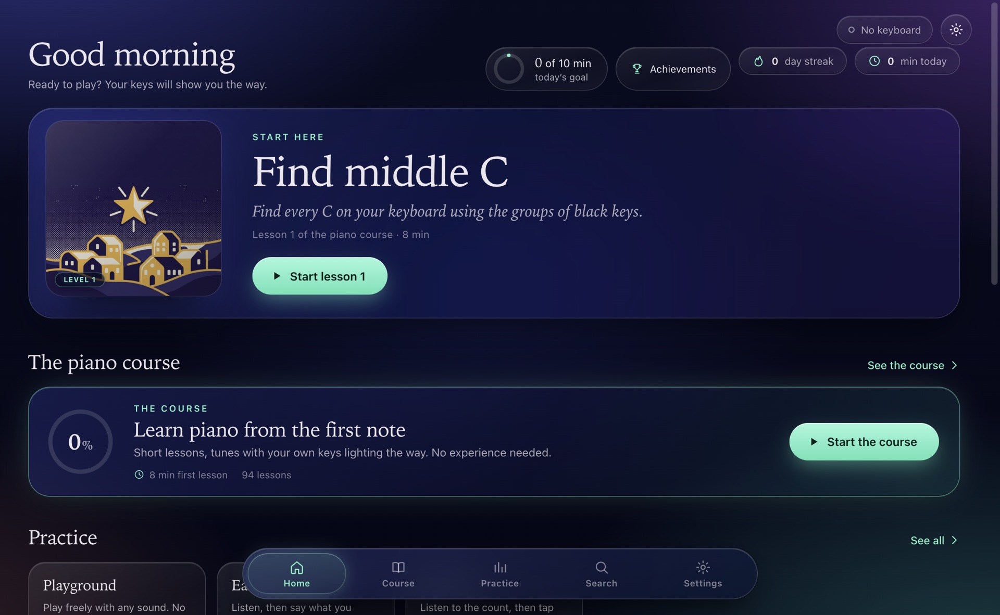
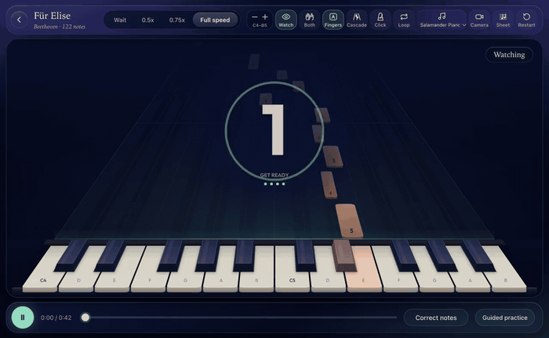
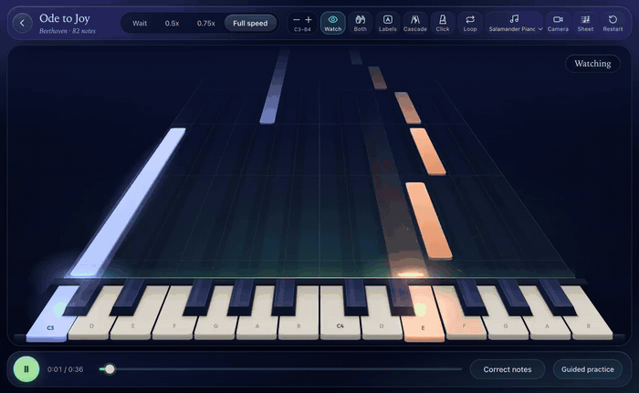
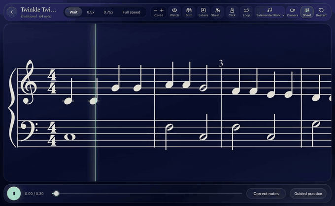
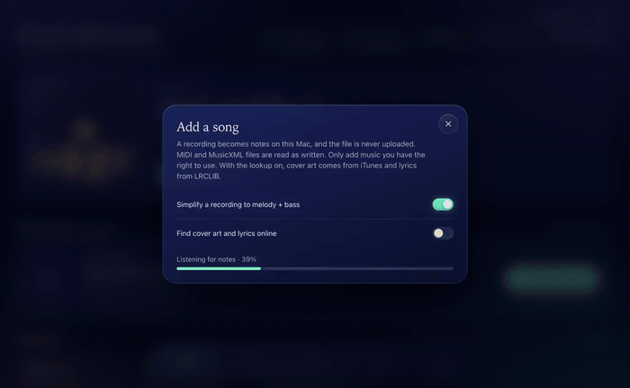
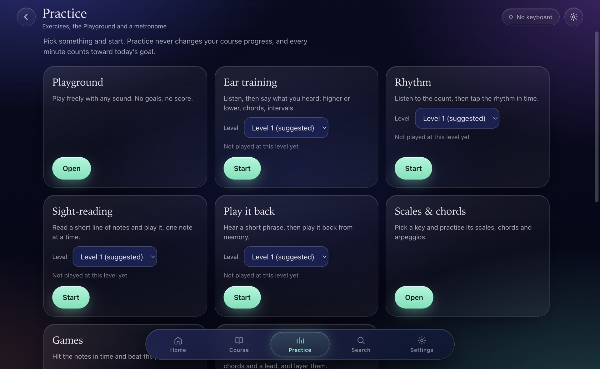

# Keylight user guide

This is the guide for playing Keylight. For the project front page see the [README](../README.md); for install, build, lighting, sound and file details see the [full reference](REFERENCE.md).

Keylight is free and open source (MIT). There is no account, no ads, no analytics and no tracking: your songs, recordings and progress stay on your device.

## Contents

- [Getting started](#getting-started)
  - [What you need](#what-you-need)
  - [First start](#first-start)
  - [The keyboard](#the-keyboard)
- [Playing a song](#playing-a-song)
  - [Find a song](#find-a-song)
  - [Speed and Wait mode](#speed-and-wait-mode)
  - [Hands and labels](#hands-and-labels)
  - [Loop, metronome and count-in](#loop-metronome-and-count-in)
  - [The octave buttons](#the-octave-buttons)
  - [Views](#views)
  - [Guided practice](#guided-practice)
  - [After a song](#after-a-song)
  - [Instruments and expression](#instruments-and-expression)
- [Adding your own songs](#adding-your-own-songs)
  - [Add a file](#add-a-file)
  - [Recordings](#recordings)
  - [MIDI and MusicXML](#midi-and-musicxml)
  - [Covers and lyrics](#covers-and-lyrics)
  - [Correct the notes](#correct-the-notes)
- [Course](#course)
- [Practice tab](#practice-tab)
- [Jam](#jam)
- [Recording your playing](#recording-your-playing)
- [Camera coach (Experimental)](#camera-coach-experimental)
- [Airwave gestures (Experimental)](#airwave-gestures-experimental)
- [Support my device](#support-my-device)
- [Backups](#backups)
- [Troubleshooting](#troubleshooting)
  - [The keys do not light up on a Mac](#the-keys-do-not-light-up-on-a-mac)
  - [The keys do not light up on Windows](#the-keys-do-not-light-up-on-windows)
  - [Keylight does not see the keyboard](#keylight-does-not-see-the-keyboard)
  - [The octave does not match the song](#the-octave-does-not-match-the-song)
  - [Windows will not open the app](#windows-will-not-open-the-app)
  - [Where my progress and the log are](#where-my-progress-and-the-log-are)
  - [The camera does not show my fingers](#the-camera-does-not-show-my-fingers)
  - [Other problems](#other-problems)
- [Supporting the project](#supporting-the-project)

## Getting started

### What you need

| System | Requirements |
|---|---|
| Mac | Apple silicon, macOS 13 or newer |
| Windows | Windows 10 or 11, 64-bit. **Beta** |
| Android | Android 8.0 or newer, installed from an APK file. **Beta** |
| iPhone and iPad | Coming soon |

Download from the [latest release page](https://github.com/scizerss/keylight-piano/releases/latest) and follow the steps for your system. Windows and Android are beta and have not yet been tested on many real devices; if something is wrong, open an [issue](https://github.com/scizerss/keylight-piano/issues).

<p align="center">
  
</p>

Home shows a continue card, the daily goal ring, your learning path, songs and the explore row. The tabs lead to the course, the search and song library, practice, jam and settings.

### First start

On first launch a short setup checks the sound, the keys and the lights.

1. Play the note the app asks for and listen for the sound.
2. Press the far-left key on the keyboard, then the far-right one, so Keylight learns which keys you have.
3. Watch the light check run across the keys.

You can run the whole setup again at any time from **Settings** > **Run setup again**.

> Note: no keyboard yet? You can still look around the app, play with the on-screen keys and read the course.

### The keyboard

Keylight works with the light-up keyboards ROLI made: LUMI Keys and ROLI Piano M, 24 keys, over USB. On Android a keyboard can also connect over Bluetooth. A 49-key ROLI Piano works (**Beta**), and two 24-key keyboards can be joined as one 48-key row, with two USB cables or snapped together with one cable (**Beta**).

What differs between systems:

- **Mac:** the keys light in full colour, and the keyboard's arrow and mode buttons work.
- **Windows:** the keys light from the notes. Not available on Windows yet: the brightness slider, the light show after a song, find-the-keys, the battery level, and the arrow and mode buttons.
- **Windows:** close ROLI Connect or any music software using the keyboard first.

Keylight is an unofficial community project. It is not affiliated with or endorsed by ROLI.

## Playing a song

### Find a song

1. Open **Search** and pick a song. There are 76 built-in songs: 19 easy arrangements and 57 classical pieces.
2. Press play, or press **Watch** to let the app play it for you first.
3. Follow the falling notes; the keyboard lights the key to play next.

### Speed and Wait mode

The speed track at the top of the player offers **Wait**, **0.5x**, **0.75x** and **Full speed**.

- In **Wait** the song stops until you play the right note. This is the mode to learn a piece in.
- At **0.5x** and **0.75x** the song plays slower, and an imported recording keeps its pitch.

### Hands and labels

- **Hands:** left, right or both. With one hand chosen, the app plays the other one for you.
- **Labels:** off, note names, or finger numbers on each note.

<p align="center">
  
</p>

### Loop, metronome and count-in

- **Loop:** mark a section and repeat it until you are happy with it.
- **Click:** a metronome over the song.
- **Count-in:** clicks before the song starts.

### The octave buttons

Move the keyboard's octave with the **−** and **+** buttons in the player, or with the **Z** and **X** keys. The app sets the keyboard's octave so its 24 keys play exactly the notes the song's window lights.

### Views

There are four note views, plus a sheet view:

- **Cascade**
- **Rainbow**
- **Colornote**
- **Classic**
- **Sheet only:** sheet music fills the stage. It is available for songs that have a score.

You can change the view in the middle of a song.

<p align="center">
  
</p>

<p align="center">
  
</p>

> Note: sheet music comes from a song's MusicXML. MIDI files and recordings do not show a score.

### Guided practice

Open a song and select **Guided practice**, the button below the keyboard.

1. Choose the hands you want to work on.
2. Start with Wait mode.
3. Play the phrases; when they are ready, the same phrases come back at faster steps.
4. Keylight brings back the bars you got wrong.

### After a song

The result shows your accuracy, timing, stars and longest streak, with the next step on the button.

### Instruments and expression

Pick an instrument from the drop-down in the toolbar: grand piano, a sampled concert grand, electric pianos, organ, harpsichord, marimba, nylon guitar, flute, cello, strings, bass, lead and pads.

Expression lives in **Settings** > **Keyboard lights** > **Pitch bend & pressure**:

- Wiggle a key to bend the pitch.
- Press into a held key to swell sustained sounds.

## Adding your own songs

### Add a file

1. Open **Search** and choose **Add a song**.
2. Or drop a file anywhere on the window.

<p align="center">
  
</p>

Your songs appear in the library marked YOURS. Hover a tile to remove one.

> Note: YouTube and Spotify links are not supported. Import a file you have.

### Recordings

MP3, M4A, WAV, FLAC, AAC, OGG and AIFF files, up to 20 minutes, are turned into notes.

- Keylight listens to the recording and writes the notes, on your computer.
- The file is never uploaded.
- It works best with piano or solo recordings.
- **Simplify to melody + bass** keeps the top line and a bass line, for an easier version on 24 keys.
- The original recording plays along in sync, and keeps its pitch at 0.5x and 0.75x.

### MIDI and MusicXML

- MIDI (`.mid`, `.midi`) and MusicXML (`.xml`, `.musicxml`, `.mxl`) files are read as written.
- Sheet music is shown for MusicXML songs only.

### Covers and lyrics

Title, artist and cover come from the file.

- On Mac and Windows, **Find cover art and lyrics online** can look them up. It sends only the title, artist and length.
- Drop a `.lrc` file onto an open song to add lyrics.

> Note: the online lookup is the only part of the desktop app that goes online, and it only happens while you import, only with the option switched on. The Android app does not make these requests. See [PRIVACY.md](PRIVACY.md).

### Correct the notes

**Correct notes** opens an editor for pitch, time, length, hand, finger and tempo, with Add, Remove and Undo. Editing a built-in song makes your own copy instead of changing the original.

## Course

The course takes you from finding middle C upward.

- 12 levels and 94 short lessons.
- Each level ends with an exam.
- **Guided** order asks before you jump ahead; **Open** order lets you go anywhere. Nothing is locked.
- There is a placement test and a skip level for people who already play.

> Note: a lesson counts as done when its exercises reach their bar. If you are new, lesson 1 of level 1 is the place to start.

## Practice tab

The Practice tab trains the skills a piece needs.

- **Ear training**, **Rhythm**, **Sight-reading** and **Play it back**: five difficulty levels each, and your best result is kept.
- **Scales & chords** in any key.
- **Games** for finding keys and reading notes.
- A **metronome**.
- The **Playground**: free play with any sound, and a scale lit on the keys.

<p align="center">
  
</p>

Practice counts toward your daily goal and your streak. The daily goal is set in Settings and can be 5 to 30 minutes.

## Jam

Jam is a small loop-based studio inside Keylight.

1. Pick a track: drums, bass, chords or lead. Each has four loop slots.
2. Record a loop; it starts and ends on the bar.
3. Build the session up, layer by layer.

The controls include the drum step grid, tempo, swing, a metronome, delay and reverb, scale lock and snap to scale. When the groove is ready, **export the session as a MIDI file**.

## Recording your playing

**Settings** > **Sound** > **Record my takes** records the falling notes, the keyboard and the app's sound as a video.

- Mac: takes are saved in **Movies** > **Keylight**.
- Windows: takes are saved in **Videos** > **Keylight**.
- A take stops by itself after 15 minutes.

## Camera coach (Experimental)

The camera coach watches your hands over the keys and shows which finger is over which key.

1. Open **Settings** > **Hand tracking** > **Start camera**.
2. Then **Find the keys** on a Mac, or **Click the end keys**.
3. Numbered finger badges appear over the keys: 1 thumb to 5 little finger, blue for the left hand and orange for the right.

Advisory finger coaching compares your fingering with the suggested one. It never changes your score.

> Note: it runs on your computer, and no video leaves it. The camera is only asked for when you press **Start camera**, and you can say no and use everything else.

> Note: it needs the whole keyboard in view. A phone on a stand above the keys works best; a laptop camera works poorly.

Its limits, honestly: it cannot tell hovering from pressing, and accuracy drops at steep angles.

## Airwave gestures (Experimental)

Keylight can use the Airwave's hand-gesture MIDI (raise, tilt, grasp) to shape the sound. Turn it on in **Settings** > **External instruments & gestures**.

Finger tracking from the Airwave is being tested with volunteers and is not confirmed to work.

## Support my device

If your keyboard is missing, unlit or only half working, **Settings** > **Support my device** helps get it supported. Five steps: **Detect**, **Test**, **About you**, **Review**, **Send**.

It builds a plain-text report: the MIDI ports, how the keyboard identifies itself, a 10-second key test (statistics only) and an optional lights check.

> Note: nothing is sent automatically. You read the report first, then you copy it, save it, or open a pre-filled GitHub issue.

Never included in the report: serial numbers, file paths, user names, song titles, recordings, progress, or the notes you played.

## Backups

**Settings** > **Progress** saves your library, settings and progress to one `.keylightbackup` file. Restore it later, or on another computer.

Keylight also keeps the last three daily automatic backups.

> Note: keep a copy of the backup file outside the app. It contains your imported songs and private settings.

## Troubleshooting

### The keys do not light up on a Mac

The packaged Mac app carries its own light service ([blocksd](https://github.com/hyperb1iss/blocksd)) and Keylight starts and restarts it, so there is nothing to install. You only need the by-hand install when you run Keylight from a source checkout (`npm start`), or when the setup screen says the key lights could not start. With [Homebrew](https://brew.sh):

```sh
brew install uv python@3.13
uv tool install --python /opt/homebrew/bin/python3.13 --from "git+https://github.com/hyperb1iss/blocksd@v0.6.0" blocksd
```

Keylight then starts it from `~/.local/bin/blocksd`.

> Note: use the `v0.6.0` tag, not `@main`. Newer blocksd releases check the WebSocket's `Origin`, which Keylight's page does not satisfy yet. A blocksd you run yourself on port 9010 is always preferred over the one in the app, and the app never stops it.

If one key is stuck lit, run **Settings** > **Keyboard lights** > **Test lights**: it sweeps a light across every key and clears any stuck light. The keyboard's battery level shows there too.

### The keys do not light up on Windows

There is no light service on Windows; it is built for macOS and Linux. Keylight lights the keys with plain MIDI notes: the note to play now, the next notes, and the notes practice waits for.

1. Close ROLI Connect and any DAW or other app that uses the keyboard. On most PCs only one app at a time can use a MIDI keyboard.
2. Check that the keyboard is plugged in over USB and switched on.
3. Run **Settings** > **Run setup again** and let the light check sweep the keys.

### Keylight does not see the keyboard

1. Open **Settings** > **Keyboard**.
2. Choose your keyboard by name. **Automatic** asks you to when it finds several inputs that do not say what they are.
3. If the keyboard is unplugged, Keylight shows it as "(not connected)" rather than switching to another input.

> Note: without ROLI's software, Windows' USB MIDI 2.0 driver calls the keyboard "USBMidi2-ACX". A port with that name only gets the key lights once you choose it by name, because any other device with that name would play them as music.

For a 49-key ROLI Piano, a port named "ROLI Piano" is recognised. Otherwise press the two end keys during the setup (**Settings** > **Run setup again**), or use **Settings** > **Number of keys** to set it yourself.

### The octave does not match the song

The app sets the keyboard's octave so its keys play the notes the song's window lights, and it recalibrates when it hears notes outside the expected range. If the screen and the keys disagree:

- Use the keyboard's own **−** and **+** buttons, or the **Octave −** / **Octave +** buttons at the top right of the player, or the **Z** and **X** keys.
- On the 49-key ROLI Piano, Keylight cannot move the keyboard's octave or ask where it is. The screen shows where the keys last were and tells you when notes sit beyond them; **−** and **+** in the player line the screen up with your keys.

### Windows will not open the app

Keylight is not code-signed, so Windows may say "Windows protected your PC".

1. Click **More info**, then **Run anyway**.
2. If you extracted a ZIP, you can avoid the warning next time: right-click the zip, **Properties**, tick **Unblock**, click **OK**, then extract it.

> Note: Windows 11 with Smart App Control switched on may block unsigned apps like Keylight without offering **Run anyway**.

### Where my progress and the log are

- **Mac:** `~/Library/Application Support/lumi-app/`. Takes are in **Movies** > **Keylight**.
- **Windows:** `%APPDATA%\lumi-app\`. Takes are in **Videos** > **Keylight**.

Progress lives there, so updating the app keeps your stars. If something goes wrong, attach `app.log` from that folder to your report.

### The camera does not show my fingers

The camera permission is only asked when you start hand tracking.

1. Check that the whole keyboard is in view.
2. A phone on a stand above the keys works best; a laptop camera works poorly.
3. On a Mac, press **Find the keys** so Keylight learns where the keys are on the picture.

### Other problems

If the app misbehaves in the player, the first things worth trying are **Settings** > **Run setup again**, closing other apps that use the keyboard, and **Settings** > **Keyboard lights** > **Test lights**. For anything else, open an [issue](https://github.com/scizerss/keylight-piano/issues) and attach `app.log`.

## Supporting the project

Keylight is free, and no features are locked. If you like it you can leave a tip at [https://ko-fi.com/scizers](https://ko-fi.com/scizers).

It is an unofficial community project, not affiliated with or endorsed by ROLI.
